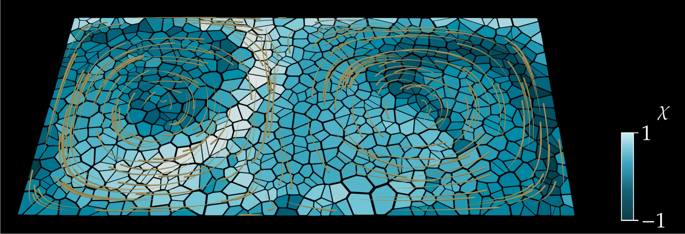

# Voronoi coherent structures

**Coherent structures in sparse particle tracks, from persistent Voronoi neighbours.**

<p align="center"></p>

Tracers that stay Voronoi neighbours over time move together. This package counts those shared edges and turns them into one colour per tracer, without choosing a number of clusters. It is a new Python implementation; the example flow is the analytic double gyre.

## Get started

```bash
git clone https://github.com/EngFlavioMartins/voronoi-coherent-structures.git
cd voronoi-coherent-structures
pip install -e .
voronoi-coherence
```

Open `outputs/demo/coherence.png`. To analyse your own 2D tracks, save them as `tracks.npz` and run `voronoi-coherence --input tracks.npz`. The equations and choices are in [docs/method.md](docs/method.md).

## Make the figure above

```bash
sh scripts/render/make_figure.sh
```

You need [ParaView](https://www.paraview.org/download/) (for `pvpython`), a LaTeX installation, and `pip install pyvista pillow`.

## Cite

This code accompanies the paper below. If you use it, please cite:

```bibtex
@misc{martins2021voronoi,
  author        = {Martins, Flavio A. C. and Rival, D. E.},
  title         = {A {Voronoi}-Tessellation-Based Approach for Detection of Coherent Structures in Sparsely-Seeded Flows},
  year          = {2021},
  eprint        = {2103.09884},
  archivePrefix = {arXiv},
  doi           = {10.48550/arXiv.2103.09884}
}
```

GitHub's **Cite this repository** button (from [CITATION.cff](CITATION.cff)) gives the same reference in other formats.

## Licence

MIT; see [LICENSE](LICENSE). The bundled IBM Plex Sans fonts use the [SIL Open Font Licence](src/voronoi_coherence/fonts/OFL.txt).
