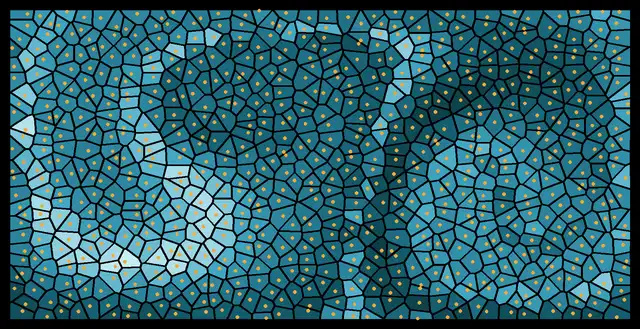

# Voronoi coherent structures

<p align="center">
  <a href="https://github.com/EngFlavioMartins/voronoi-coherent-structures/actions/workflows/tests.yml"></a>
  <a href="https://doi.org/10.48550/arXiv.2103.09884"></a>
  <a href="https://www.python.org/"></a>
  <a href="https://github.com/EngFlavioMartins/voronoi-coherent-structures/blob/HEAD/LICENSE"></a>
  <a href="https://engflaviomartins.github.io/#voronoi-coherence"></a>
</p>

**Coherent structures in sparse particle tracks, from persistent Voronoi neighbours.**

<p align="center"></p>

Tracers that stay Voronoi neighbours over time move together. This package counts those shared edges and turns them into one colour per tracer, without having to choose a number of clusters. The example flow is the analytic double gyre.

## Run it

```bash
git clone https://github.com/EngFlavioMartins/voronoi-coherent-structures.git
cd voronoi-coherent-structures
python run.py
```

`run.py` analyses 400 double-gyre tracers and saves the result to `outputs/demo/coherence.png`. The first time, it installs what it needs into a private `.venv` folder (a minute or so); after that it starts at once. All you need is Python 3.10 or newer.

<details>
<summary>Prefer conda?</summary>

```bash
conda env create -f environment.yml
conda activate voronoi-coherent-structures
python -m voronoi_coherence.cli
```

</details>

**Next:** To analyse your own 2D tracks, save them as `tracks.npz` and run `python run.py --input tracks.npz`. The equations and choices are in [docs/method.md](docs/method.md).

## Figure and animation

<p align="center"></p>

The Voronoi cells of the tracers at the end of the record, coloured by coherence, with short amber trails of their recent motion.

```bash
sh scripts/render/make_figure.sh          # the figure
python scripts/render/make_animation.py   # the animation at the top
```

The figure needs [ParaView](https://www.paraview.org/download/) and LaTeX; the animation only Python.

## Cite

This code accompanies the paper below. If you use it, please cite:

```bibtex
@misc{martins2021voronoi,
  author        = {Martins, Flavio A. C. and Rival, D. E.},
  title         = {A {Voronoi}-Tessellation-Based Approach for Detection of Coherent Structures in Sparsely-Seeded Flows},
  year          = {2021},
  eprint        = {2103.09884},
  archivePrefix = {arXiv},
  doi           = {10.48550/arXiv.2103.09884}
}
```

GitHub's **Cite this repository** button (from [CITATION.cff](CITATION.cff)) gives the same reference in other formats.

## Licence

[Apache 2.0](LICENSE): you are free to use, change and share this code, also commercially. If you pass it on, keep the [NOTICE](NOTICE) file with it; it says where the code comes from and how to cite it.

The bundled IBM Plex Sans fonts use the [SIL Open Font Licence](src/voronoi_coherence/fonts/OFL.txt).
